# Adaptive Night Vision on an FPGA

Real-time low-light video enhancement on a **Terasic DE10-Standard** (Intel Cyclone V SoC). A frame-driven hardware pipeline brightens dark video, removes noise without smearing motion, and re-tunes itself every frame, with no knob to turn. Frames go from a laptop over Ethernet, through the HPS (ARM) into DDR3, through the FPGA engine and back, and are shown live on the laptop.

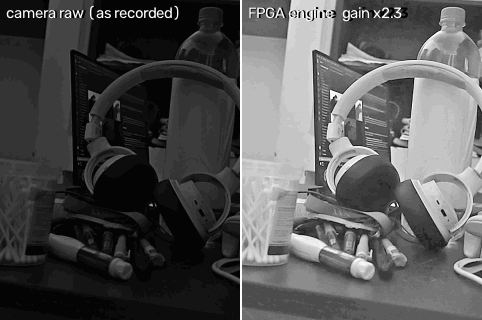

*Left: the camera's raw frame exactly as recorded. Right: the output of the FPGA, captured from the board. ISO 2000, 1/60 s, 640x480 grey scale.*

## What it does

| | |
|---|---|
| **Input** | 640x480, 8-bit luma, any frame rate up to 59.5 fps |
| **Pipeline** | temporal denoise (motion adaptive) -> spatial denoise -> tone map -> unsharp mask with coring |
| **Self-tuning** | a controller measures the output of every frame and sets gain, black level and filter strengths for the next one (about x1 to x32 of gain) |
| **Hardware** | one 25 MHz clock, 5,957 ALMs (14 %), 17 DSP blocks, 56 % of block RAM, all timing met |
| **Verified** | bit-exact against two independent integer models, on the simulator and on the board |
| **Display** | no VGA needed: enhanced frames stream to a Python viewer on the laptop |

### Headline results (all numbers measured on the board)

* **Bit-exact:** 3,368 frames from 11 real clips and 5 sampled LOL images processed by the FPGA matched the integer model **bit for bit**. The evaluation script refuses to report a number otherwise.
* **LOL benchmark, 50 paired images:** PSNR **20.3 dB** against 15.3 dB for the best baseline (histogram equalisation); SSIM 0.684, about the same as a plain gamma curve (0.695). It beats all three baselines on 39/50 images in PSNR.
* **Very dark real scene (ISO 2000):** the temporal filter cuts noise by **3.7x** (temporal std 6.19 -> 1.67 grey levels); the full engine reaches a signal-to-noise ratio of 55 where gamma, histogram equalisation and CLAHE all stay at about 13.
* **Throughput:** about 25 frames/s end to end over Ethernet. The FPGA itself runs at 59.5 frames/s; the HPS memory copy and TCP are the bottleneck.
* **Honest limits:** in moderately dark scenes the engine is **not** cleaner than a fixed gamma curve (it deliberately turns denoising down when the noise estimate is small), and a lamp switch causes a one-frame brightness flash. Details in [Results](#results) and [Limitations](#limitations).

## Demo

**Brightening a real low-light image** (LOL dataset, processed by the FPGA on the board): input, FPGA output and ground truth side by side. The controller reaches the target brightness within a frame or two.

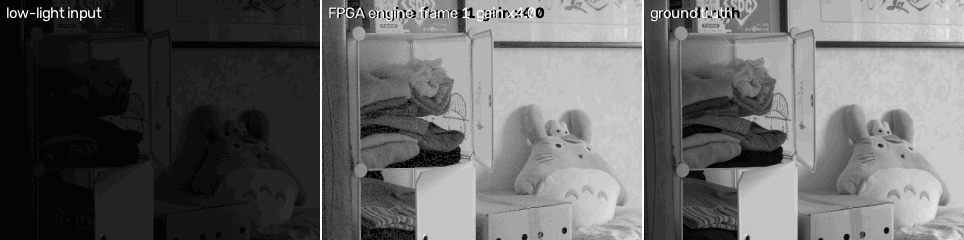

**Your own night clips** (raw is shown exactly as recorded, not brightened):

| Lamp switched on and off, gain falls and recovers | Very dark scene |
|---|---|
| 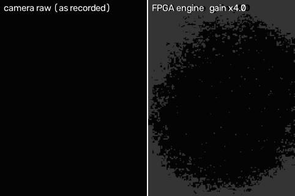 | 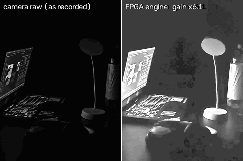 |

| Moving hand, no ghost trail | Dim room |
|---|---|
| 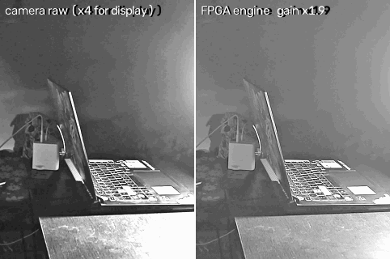 |  |

Full-quality H.264 versions: [LOL brightening](docs/media/demo_lol_brightening.mp4), [lamp step](docs/media/demo_lampstep.mp4), [dim room](docs/media/demo_dimroom.mp4), [very dark](docs/media/demo_verydark.mp4), [motion](docs/media/demo_motion.mp4). Every frame in these clips was produced by the FPGA.

## Architecture

The diagrams are Mermaid sources in [docs/diagrams/](docs/diagrams/), pre-rendered to images by `scripts/render_diagrams.py` so they show up in every viewer.

### System

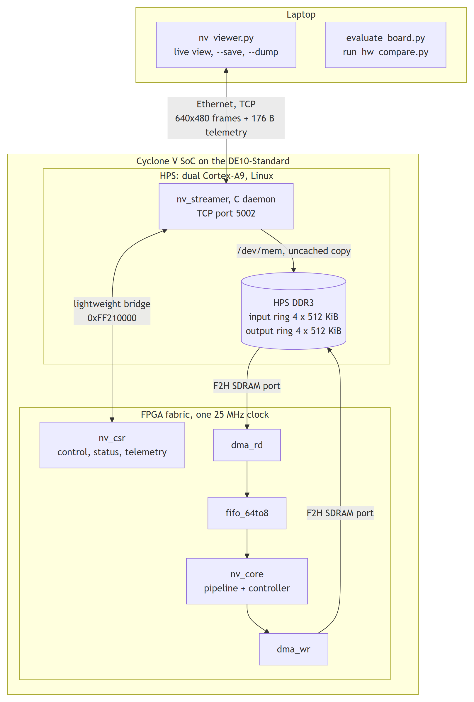

<sub>Diagram source: [docs/diagrams/system.mmd](docs/diagrams/system.mmd) (Mermaid).</sub>

There is no VGA monitor in this setup, so the display boundary is the network. The HPS image has no usable Python, so a small C daemon owns `/dev/mem` and the laptop talks a simple framed TCP protocol ([docs/streaming.md](docs/streaming.md)).

### Enhancement pipeline (`rtl/nv_core.v`)

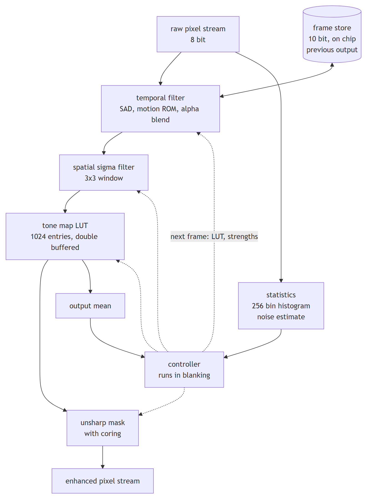

<sub>Diagram source: [docs/diagrams/pipeline.mmd](docs/diagrams/pipeline.mmd) (Mermaid).</sub>

* **Temporal** (`nv_temporal.v`): the 3x3 sum of absolute differences against the stored previous output picks a blend factor from a motion ROM. Still areas average over time, moving areas pass through (no ghost trail). The frame store is one 10-bit (Q8.2) frame in on-chip RAM, updated in place.
* **Spatial** (`nv_spatial.v`, `win3x3.v`): a sigma filter that only averages neighbours within a noise-dependent threshold, so edges survive.
* **Tone map** (`nv_tone.v`): a 1024-entry LUT with gamma, black level and gain, rebuilt every frame during blanking and swapped in without tearing.
* **Sharpen** (`nv_sharpen.v`): unsharp mask with coring so it does not amplify noise-level detail.
* **Statistics** (`nv_hist.v`, `nv_noise.v`): 256-bin histogram, an Immerkaer noise estimate and the output sum, gathered while the frame streams past.

### Controller (`rtl/nv_ctrl.v`, design in [docs/controller.md](docs/controller.md))

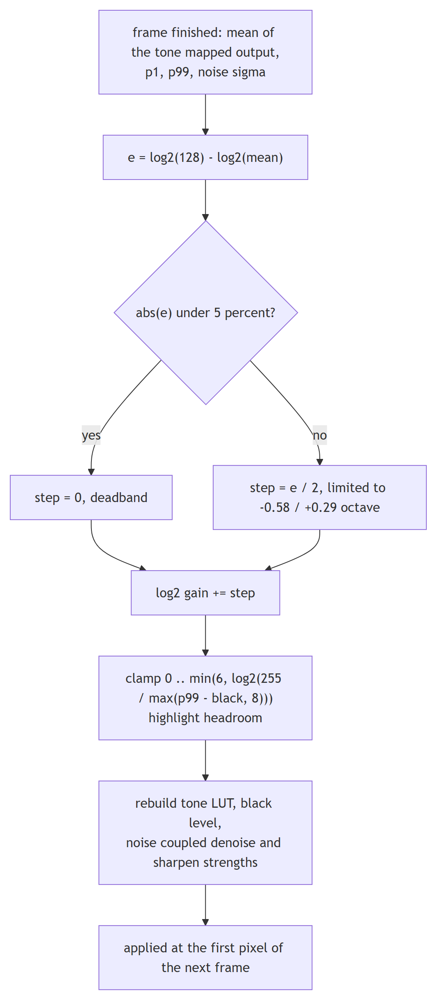

<sub>Diagram source: [docs/diagrams/controller.mmd](docs/diagrams/controller.mmd) (Mermaid).</sub>

The loop is first-order with one frame of delay and contraction 0.8 per frame, so it cannot oscillate; a deliberately over-aggressive setting (k = 5) was measured to flicker between two gains every frame ([step response](docs/results/step_response_moderate.md)). The highlight clamp is the reason the effective maximum gain is about x32, not the nominal x64.

### One frame, end to end

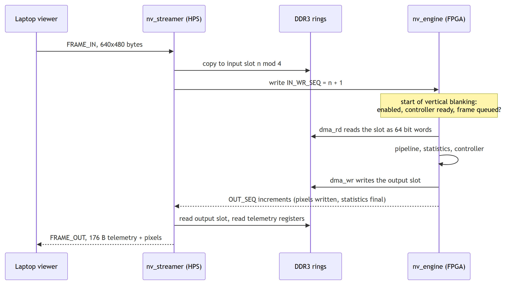

<sub>Diagram source: [docs/diagrams/frame_sequence.mmd](docs/diagrams/frame_sequence.mmd) (Mermaid).</sub>

At most 3 frames are in flight, so memory is bounded and latency stays under about 4 frame times. The register map is in [docs/csr_map.md](docs/csr_map.md).

### Design rules that were followed

The project was planned against a checklist of mistakes from an earlier FPGA project ([fpga_checklist_updated.md](fpga_checklist_updated.md)): one clock domain, lock-gated reset, standalone RAM modules with registered reads, one driver per register, STA on every build with every required clock present in the slack table, compressed `.rbf`, explicit JTAG device index, a `VERSION` register that the host software checks, and a bug log with symptom, root cause, fix and lesson.

## Results

All numbers below come from `scripts/evaluate_board.py`: the frames went through the real FPGA, and the script re-ran the integer model on the same inputs and **aborted unless the outputs were identical**. Baselines are applied to the same input frames at the same size.

### LOL paired benchmark (50 images)

LOL images were resized to 640x480 and fed to the board as 24 identical frames so the controller settles; the last output frame is scored. Mean +/- standard error.

| method | PSNR (dB) | SSIM | LOE (lower is better) | mean luma | noise sigma |
|---|---|---|---|---|---|
| raw | 7.59 +/- 0.35 | 0.174 +/- 0.018 | 0.064 | 14.4 | 0.57 |
| gamma 0.4 | 14.27 +/- 0.60 | **0.695** +/- 0.018 | 0.064 | 71.8 | 2.37 |
| histogram equalisation | 15.30 +/- 0.39 | 0.482 +/- 0.021 | 0.064 | 128.4 | 7.36 |
| CLAHE | 9.33 +/- 0.45 | 0.394 +/- 0.022 | 0.129 | 31.2 | 1.57 |
| **FPGA engine** | **20.29** +/- 0.58 | 0.684 +/- 0.014 | 0.071 | 127.3 | 4.75 |

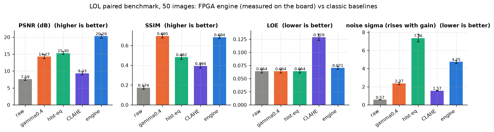

* The engine wins PSNR by about 5 dB because it regulates the output to a calibrated brightness (mean 127) instead of using a fixed curve.
* SSIM is a tie with gamma 0.4 (the difference is inside the error bars); the engine beats all three baselines in SSIM on 28 of 50 images.
* The output noise sigma rises with gain: the engine's controller applied an average gain of about x5 (x1.1 to x10.8 across the 50 images), so some noise comes with it. Histogram equalisation has more noise at similar brightness (7.36).
* LOE (lightness order error) is slightly worse than the monotone baselines (0.071 vs 0.064).

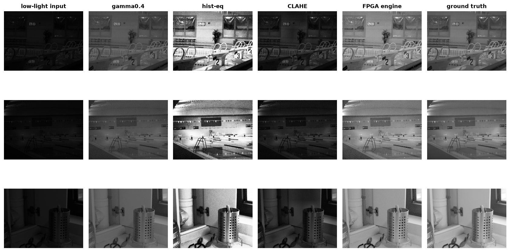

### Real night clips (your own camera, ISO 2000, 1/60 s)

These clips have no ground truth, so the table uses no-reference measures on static scenes: temporal noise is the standard deviation of every pixel over time (a static scene should be constant, so this is pure noise and flicker). Full table: [docs/results/hw_eval_clips.md](docs/results/hw_eval_clips.md).

| clip | method | mean luma | temporal std | SNR = mean / std | spatial sigma |
|---|---|---|---|---|---|
| very dark | raw | 7.6 | 0.60 | 12.8 | 0.41 |
| very dark | gamma 0.4 | 43.9 | 3.18 | 13.8 | 1.05 |
| very dark | histogram equalisation | 176.8 | 12.93 | 13.7 | 2.93 |
| very dark | CLAHE | 17.1 | 1.30 | 13.2 | 0.68 |
| very dark | **FPGA engine** | **87.3** | **1.59** | **55.0** | 1.82 |
| dim room | raw | 28.4 | 1.01 | 28.0 | 0.38 |
| dim room | gamma 0.4 | 95.8 | 2.01 | 47.6 | 0.78 |
| dim room | histogram equalisation | 130.1 | 4.07 | 32.0 | 1.74 |
| dim room | CLAHE | 52.8 | 2.26 | 23.4 | 0.93 |
| dim room | FPGA engine | 133.7 | 3.51 | 38.1 | 1.79 |

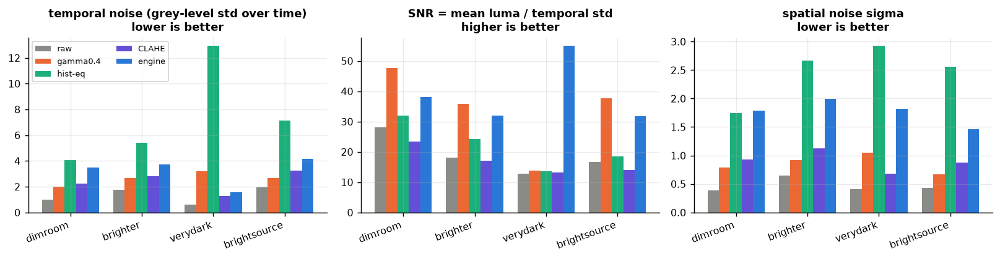

How to read this honestly:

* **Very dark:** this is where the temporal filter earns its place. The engine raises the brightness to 87 while ending up with less temporal noise (1.59) than gamma (3.18) at half the brightness, and 8x less than histogram equalisation.
* **Dim room and brighter scenes:** the engine is brighter than every baseline but **not cleaner than gamma 0.4**. A concave curve such as gamma compresses noise in the highlights, which inflates a mean/std ratio, so SNR flatters it. The engine's noise-coupled controller also switches temporal and spatial filtering down when the noise estimate is low (next section), and sharpening adds a little noise back.
* Against the well-exposed ISO-200 reference of the same static scene ([table](docs/results/hw_eval_clips.md)) the engine scores PSNR 8.32 dB and SSIM 0.215, a little above the raw frame (7.45 dB, 0.192) and below gamma 0.4 (9.57 dB, 0.266). Its output is brighter than the reference exposure (mean 134 against 102), which PSNR penalises; no method gets close to the reference.

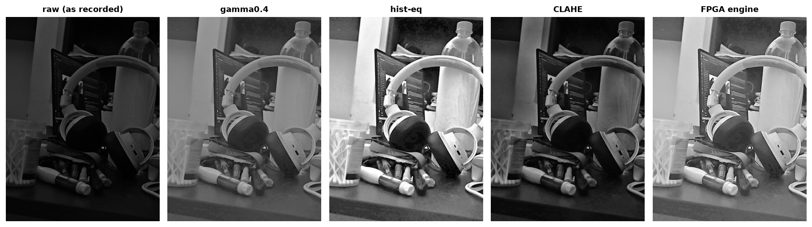

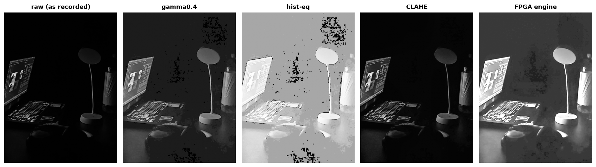

### What each stage buys (measured on the board)

The same clips with the temporal, spatial and sharpen stages switched off one by one through the CSR enable bits. The controller is unchanged, so the gain and the brightness are the same in every row. Source: [docs/results/hw_eval_ablation.md](docs/results/hw_eval_ablation.md).

| clip | stages | mean luma | temporal std | SNR | spatial sigma |
|---|---|---|---|---|---|
| very dark | tone map only | 86.5 | 6.19 | 14.0 | 2.28 |
| very dark | + temporal | 87.3 | 1.67 | 52.3 | 2.13 |
| very dark | + temporal + spatial | 87.5 | **1.48** | **59.2** | **1.57** |
| very dark | full (+ sharpen) | 87.3 | 1.59 | 55.0 | 1.82 |
| dim room | tone map only | 133.6 | 2.84 | 47.1 | 1.10 |
| dim room | + temporal + spatial | 133.6 | 2.84 | 47.1 | 1.10 |
| dim room | full (+ sharpen) | 133.7 | 3.51 | 38.1 | 1.79 |

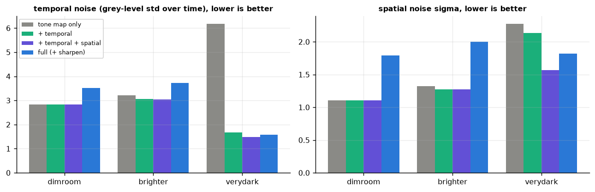

* In the very dark scene temporal filtering removes **73 %** of the temporal noise and spatial filtering lowers it by a further 0.2 grey levels.
* In the dim room the filters change nothing, by design: the telemetry shows the controller measured a noise sigma of 0.38 and chose a temporal blend of 1.0 (pass-through) and a spatial mix of 0. In the very dark scene it measured 0.41 at a gain of x6, and chose a temporal blend floor of 0.125 (average over about 8 frames), a spatial mix of 1.0 and a sharpen strength of 0.25. A fixed-strength denoiser would blur the first scene for no gain.
* Sharpening costs about 0.7 grey levels of temporal noise in a clean scene. The simulated ablation on synthetic video ([lol](docs/results/ablation_lol.md), [moderate](docs/results/ablation_moderate.md), [harsh](docs/results/ablation_harsh.md)) shows the same ordering with exact ground truth.

### Self-tuning: the lamp step

A lamp is switched on in steps and off again. The controller gain below was read back from the FPGA's own telemetry registers.

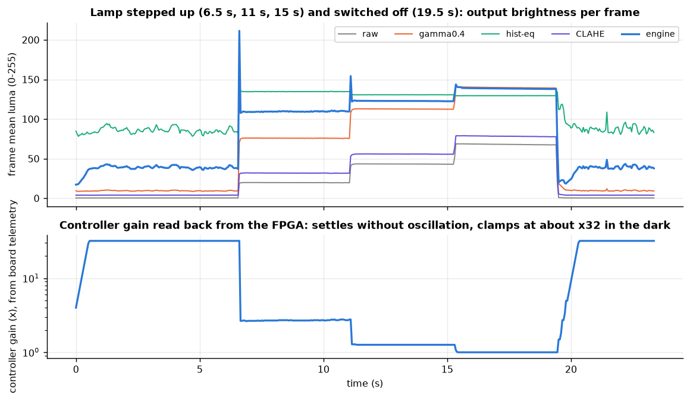

* In the dark the gain sits at its clamp of about **x32** and the output mean is about 40, not 128: the scene is too dark for gain alone to reach the target without clipping noise, and the headroom clamp stops it.
* When the lamp comes on the gain **drops at once** (the p99 highlight clamp acts on the state in the same frame) and then settles; when it goes off the integrator climbs back at the rate limit of about 0.3 octave per frame (about 0.7 s for x1 to x32).
* The first frame after the lamp is switched on is rendered with the old gain, because new parameters apply from the next frame: the output mean spikes for **one frame** (about 210). This is the one-frame parameter delay of the architecture, and it is visible in the plot.

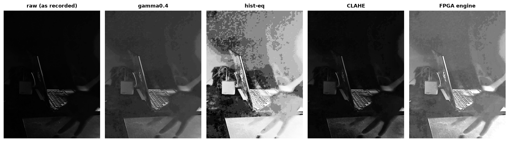

## Verification

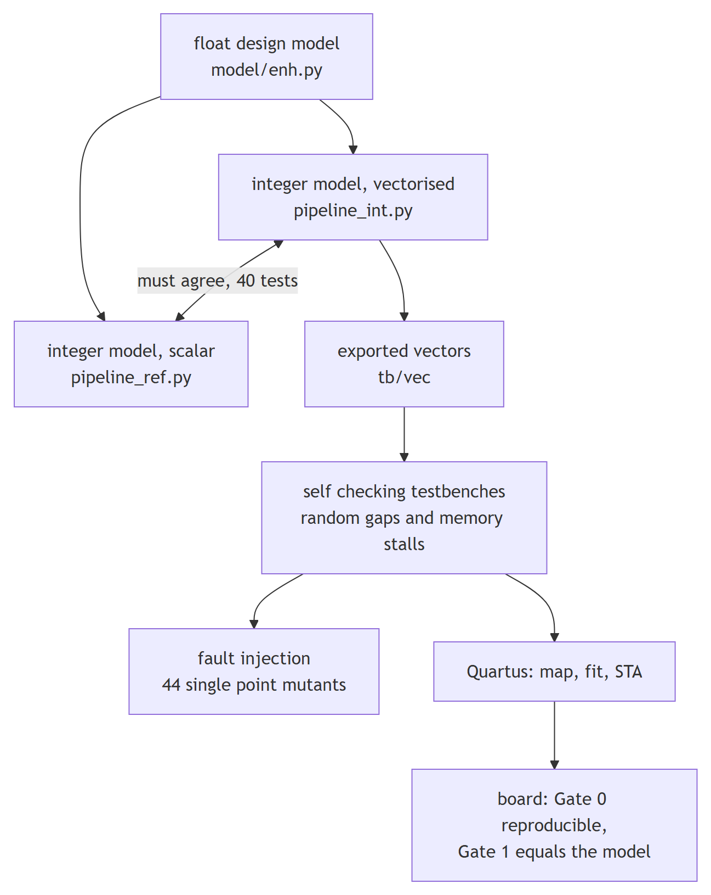

<sub>Diagram source: [docs/diagrams/verification.mmd](docs/diagrams/verification.mmd) (Mermaid).</sub>

* **Two independent golden models** (a vectorised and a scalar implementation, written separately) agree on every test; the RTL is compared to them pixel for pixel. The Python side has 46 tests (`pytest`).
* **Testbenches** drive random valid gaps (0 to 80 %), memory wait states up to 70 %, queued frames and a reset in the middle, for the core, the controller (8,840 cases plus an 8,000-case soak) and the whole engine.
* **Fault injection** (`scripts/run_regression.py --selftest`): single-point faults are planted into the RTL and each must be caught by a testbench. The first batch let about half through, which exposed blind spots in the test vectors (exact deadband edges, rounding ties, very dark scenes, a stale counter after reset); they were closed with directed tests, and two mutants were proven unobservable. The final re-run of the last two test fixes is still pending (see [Status](#status)).
* **On the board:** `scripts/run_hw_compare.py` checks reproducibility after a reset (Gate 0) and equality with the model with a +/- 2 frame offset sweep before it will report a value mismatch (Gate 1, so a dropped frame is not confused with wrong pixels). Its own logic is self-tested.
* **Timing:** STA on the whole SoC with every clock in the tables (CLOCK_50, the 25 MHz PLL output and the DDR3 interface clocks): setup slack +10.6 ns on the 25 MHz clock and +1.7 ns on the tightest DDR3 clock, hold slack positive in all corners.

### Bugs worth reading

[docs/bug_log.md](docs/bug_log.md) has ten entries with symptom, root cause, fix and lesson. Three of them show why checking on hardware matters:

* **#9:** the first full build passed STA with the DDR3 sequencer ROMs initialised to zero, because a crashing generation step silently dropped two files. Only a critical warning in the log showed it; the build script now fails on it.
* **#10:** the engine worked in simulation but did nothing on the board: the preloader on the SD card left the FPGA-to-SDRAM ports in reset. Marker patterns planted in the output buffer proved that no write ever arrived. The daemon now releases the ports.
* **#6:** two `always` blocks drove the same registers. The simulator accepted it, Quartus did not.

## FPGA implementation

Device `5CSXFC6D6F31C6`, Quartus Prime Lite 21.1, whole SoC (HPS, DDR3 controller, Platform Designer interconnect and the engine):

| resource | used |
|---|---|
| ALMs | 5,957 / 41,910 (14 %) |
| registers | 8,275 |
| block memory | 3.18 Mbit / 5.66 Mbit (56 %), 404 of 553 M10K |
| DSP blocks | 17 / 112 (15 %) |
| PLL | 1 (50 -> 25 MHz) |
| bitstream | 3.3 MB compressed `.rbf` |

The 640x480 core alone synthesises to 2,323 ALMs and 17 DSP blocks. The frame store is 10 bits per pixel (Q8.2): the bit-width study ([docs/results/bitwidth.md](docs/results/bitwidth.md)) showed 8 bits cost up to 0.3 dB of PSNR against the float model and 10 bits stay within 0.1 dB, for 54 % of block RAM.

## Repository layout

| path | contents |
|---|---|
| `rtl/` | Verilog: `nv_core` and its stages, `nv_ctrl` (controller FSM), DMAs, CSR block, `nv_engine` (scheduler), ROM generators' output in `rtl/rom/` |
| `tb/` | self-checking testbenches (`nv_core_tb`, `nv_ctrl_tb`, `nv_engine_tb`, ...) |
| `model/` | float design model, two bit-exact integer models, baselines, metrics, low-light simulator, tests |
| `sw/` | `nv_streamer.c` (HPS daemon), `sw/host/` (protocol, simulated board) |
| `scripts/` | regression and fault injection, vector export, build scripts, `nv_viewer.py`, `evaluate_board.py`, `run_hw_compare.py`, `make_demo_media.py` |
| `quartus/` | `bringup/` (clock/LED/HEX test design), `core/` (synthesis-only core), `soc/` (the board system: Platform Designer, top level, constraints) |
| `docs/` | `bringup.md`, `controller.md`, `streaming.md`, `csr_map.md`, `board_notes.md`, `bug_log.md`, `results/`, `img/`, `media/` |
| `roadmap_3_adaptive_night_vision.md` | the plan, with status of every task |

## Reproduce

### Python models and tests (no hardware)

```bash
python -m venv .venv && .venv/Scripts/pip install -r requirements.txt     # Windows; use bin/ on Linux
.venv/Scripts/python -m pytest                                            # 46 tests
.venv/Scripts/python -I scripts/export_vectors.py small_nat               # test vectors for the RTL
.venv/Scripts/python -I scripts/run_regression.py                         # all testbenches (needs Icarus Verilog)
.venv/Scripts/python -I scripts/run_regression.py --selftest              # fault injection
```

### Demo without a board

```bash
python -I scripts/nv_viewer.py --source your_clip.mp4 --sim              # simulated board running the integer model
```

### Build the bitstream

```bash
bash scripts/build_soc.sh            # map, merge, pin assignments, fit, STA, compressed rbf (about 15 to 60 minutes)
```

The script fails if timing is not met, if a required clock is missing from the slack tables, or if a memory initialisation file is missing. `--generate` also re-runs Platform Designer; on the author's machine its DDR3 sequencer step crashes and `scripts/patch_qip.py` repairs the output (bug log #7 and #9).

### Run on the board

1. Copy `quartus/soc/output_files/DE10_Standard_NV.rbf` to the SD card's FAT partition as `soc_system.rbf` (keep a backup of the old one) and boot with `SW10 = 01010`.
2. Copy `sw/nv_streamer.c` to the board and build it there: `gcc -std=gnu99 -O2 -o nv_streamer nv_streamer.c`.
3. On the board: `./nv_streamer --ddr-base 0x30000000`.
4. On the laptop:

```bash
python -I scripts/nv_viewer.py --source clip.mp4 --connect <board ip>                 # live view
python -I scripts/nv_viewer.py --source clip.mp4 --connect <board ip> --save out.mp4  # keep a recording
python -I scripts/nv_viewer.py --source clip.mp4 --connect <board ip> --headless --dump run.npz
python -I scripts/run_hw_compare.py --model run.npz                                   # board vs model, frame by frame
```

Full procedure with the gate after each step: [docs/bringup.md](docs/bringup.md). Board facts (JTAG order, memory map, network): [docs/board_notes.md](docs/board_notes.md).

### Regenerate the evaluation

```bash
python -I scripts/evaluate_board.py capture --host <board ip>     # LOL benchmark and clips through the board
python -I scripts/evaluate_board.py ablation --host <board ip>    # stages switched off through the CSR bits
python -I scripts/evaluate_board.py analyze                       # metrics and figures
python -I scripts/make_demo_media.py                              # GIFs and mp4 (needs imageio-ffmpeg)
```

## Limitations

* **Luma only, fixed 640x480.** Colour is not processed; other resolutions need a parameter change and a rebuild.
* **One-frame parameter delay.** A sudden scene change is rendered with the previous frame's settings (the flash in the lamp-step plot).
* **Gain ceiling about x32.** Scenes darker than that stay dark rather than turning into amplified noise.
* **Noise-coupled filtering means no visible denoising in clean scenes.** That is intended, but it means the engine does not beat a fixed gamma curve in noise there; the big gain is in the dark.
* **Throughput is limited by the HPS.** About 25 frames/s over Ethernet; the FPGA does 59.5.
* **A preloader workaround.** The SD card's preloader leaves the FPGA-to-SDRAM ports in reset; the daemon releases them from Linux. The proper fix is a preloader rebuilt from `quartus/soc/hps_isw_handoff`.
* **Evaluation data.** BVI-RLV (real low-light video with ground truth) was not available, so video quality is measured on your own clips without ground truth (plus synthetic clips built from LOL), and the LOL benchmark uses still images repeated as video.
* **The hardware ablation is not model-checked** (the integer model has no stage-enable switches); the full pipeline is.

## Status

Done: algorithm and tuning, all RTL, simulation and fault injection, SoC build with timing met, board bring-up, hardware bit-exact verification, laptop streaming, evaluation. Open: the one-hour soak test with a repeat of Gate 0, a final re-run of the last two fault-injection batches, a rebuilt preloader, and a mode where the ARM can override the controller. See [the roadmap](roadmap_3_adaptive_night_vision.md).

## Data and acknowledgements

* LOL dataset: C. Wei, W. Wang, W. Yang, J. Liu, *Deep Retinex Decomposition for Low-Light Enhancement*, BMVC 2018. The data is not redistributed here (`data/` is git-ignored); see [docs/datasets.md](docs/datasets.md).
* The night clips were recorded by the author with a phone camera app at ISO 2000, 1/60 s, and are not part of the repository; the GIF and MP4 demos are frames produced by the FPGA from them.
* Platform Designer system derived from the Terasic DE10-Standard GHRD example.
